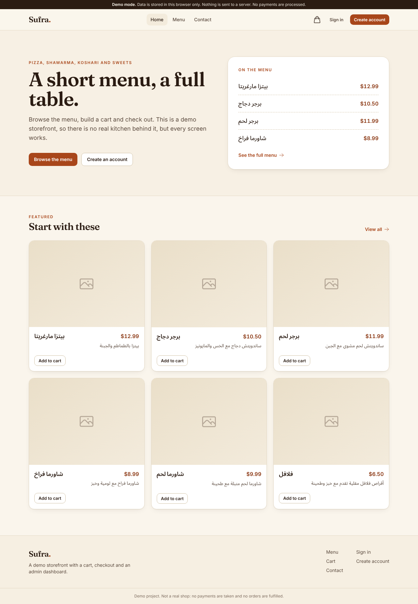
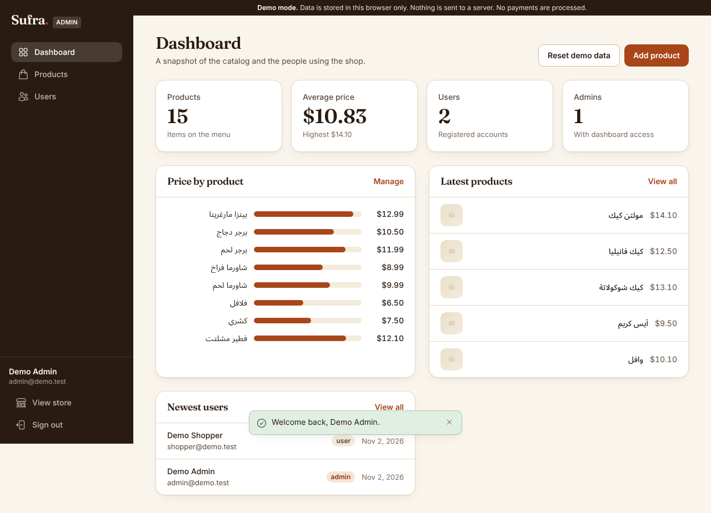

# Sufra: storefront and admin dashboard

A small online food shop with a customer storefront and an admin dashboard, built with
React, Vite and Tailwind CSS. It runs with no server at all in **demo mode**, and can use
**Firebase** (Auth and Firestore) when you provide a project.

Live demo: https://e-commerce-with-dashboard.vercel.app (this link may still serve the
earlier version of the app until it is redeployed from this branch).




Product photos come from remote URLs stored in the data. When an image cannot load, the
app shows a neutral placeholder, which is what the screenshots above show because the
sandbox they were taken in had no access to those hosts.

## What is in it

Storefront
- Home, menu with search and sorting (kept in the URL), product detail pages
- Cart saved in the browser, quantity steppers, shipping and tax totals
- Checkout form with validation and an order confirmation (a simulation, see limitations)
- Sign in, sign up, profile, contact form

Admin dashboard (admins only, `/admin`)
- Dashboard cards, price chart, latest products and newest users
- Products and users tables with search, sortable columns and pagination
- Add, edit, view and delete products, with a confirm dialog and image preview
- Change user roles or delete users (you cannot change or delete yourself)

Loading skeletons, empty states and error states with a retry button on every data view.
Keyboard accessible, visible focus rings, skip link, `prefers-reduced-motion` respected.

## Stack

React 18, React Router 7, React Hook Form, Tailwind CSS 3, Vite 6, Firebase 12 (optional),
Vitest. Fonts (Fraunces, Inter, Noto Sans Arabic) are self-hosted through `@fontsource`.

## Run it

```bash
npm install
npm run dev        # http://localhost:5173
npm test           # unit tests
npm run lint
npm run build
```

With no environment variables the app starts in demo mode.

### Demo mode (default)

Products and accounts live in `localStorage`. Passwords are never stored in plain text:
they are salted and hashed with PBKDF2 (WebCrypto). The sign in page lists two fake demo
accounts you can use, an admin and a shopper. **Reset demo data** on the dashboard restores
the starting state.

### Firebase mode

Copy `.env.example` to `.env` and fill in the web app config of your Firebase project.
Variable names: `VITE_FIREBASE_API_KEY`, `VITE_FIREBASE_AUTH_DOMAIN`,
`VITE_FIREBASE_PROJECT_ID`, `VITE_FIREBASE_STORAGE_BUCKET`,
`VITE_FIREBASE_MESSAGING_SENDER_ID`, `VITE_FIREBASE_APP_ID`. Set `VITE_BACKEND=demo` to
force demo mode.

You also need to enable Email/Password (and Google, if you want it) in Firebase
Authentication and create a Firestore database. Data layout: `users/{uid}` with
`fullName`, `email`, `phone`, `role`, `createdAt` and `products/{id}` with `title`,
`productDescription`, `price`, `img`, `createdAt`. Make your first admin by setting
`role` to `admin` on that user document in the Firebase console. An admin can then import
the sample products from an empty menu.

If the configured backend cannot be reached, the app says so and offers to continue with
demo data.

## Demo data

- The fake demo accounts in `src/services/demoSeed.js` (`admin@demo.test`,
  `shopper@demo.test`) are for demo mode only. They are shown on purpose on the sign in page.
- `db.json` is the original json-server style seed. Only its `products` are used by the app.
  Its `users` records are legacy data from the earlier version, are not loaded or shipped in
  the bundle, and should not be treated as real credentials. Do not reuse those passwords.
- Shipping ($5, free over $50) and tax (5%) are demo values in `src/lib/config.js`.

## Tests and CI

`npm test` runs Vitest unit tests for cart totals, table search, sorting and pagination,
product validation and the demo backend (including password hashing). GitHub Actions
(`.github/workflows/ci.yml`) runs lint, tests and a production build on every push and pull request.

## How this was verified

I ran `npm run lint`, `npm test` and `npm run build` (all pass), then drove the demo mode
app in headless Chromium at 1280x800 and 390x844: browsing, search and sort, cart, checkout
validation and order placement, role guard on `/admin`, product create and delete, table
sorting, empty and 404 states, with no console errors. **The Firebase mode has not been
run against a real Firebase project** because no credentials were available.

## Known limitations

- Checkout is a simulation: no payment, no stored orders, no emails. The contact form
  does not send messages.
- In Firebase mode the `admin` role is a field in Firestore. It is only meaningful if you
  add Firestore security rules that stop users from editing their own `role`. No rules file
  is included. Deleting a user in the dashboard removes the Firestore profile, not the
  Firebase Auth account.
- Demo mode is browser-only, so nothing is shared between devices and the data is not
  secure. Do not enter real personal data.
- Product titles and descriptions in the seed data are in Arabic. Text direction is set per
  element, but the interface copy itself is English only.
- Hosting on a static host needs a rewrite of all paths to `index.html` for deep links.

Notes: UI and code quality improvements were made with AI assistance (Claude, Anthropic), reviewed and verified by building and running the app.
